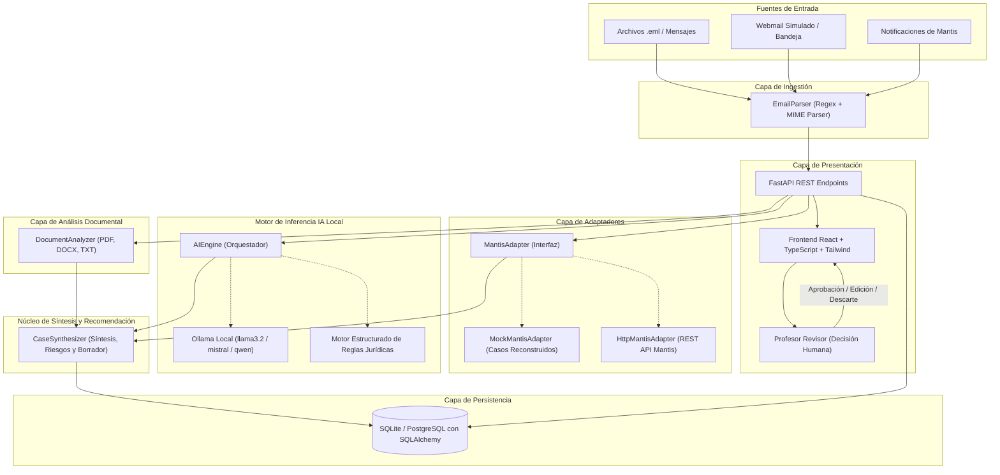
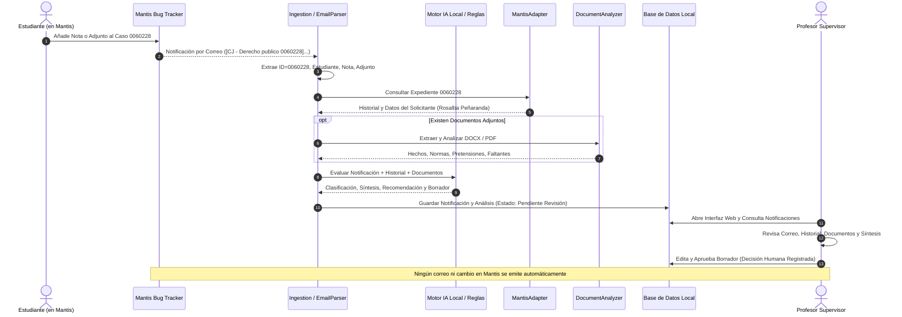

# Arquitectura y Flujo del Sistema MVP
**Automatización de Revisión de Notificaciones de Mantis - Consultorio Jurídico**

---

## 1. Visión General de la Arquitectura

El sistema implementa una arquitectura desacoplada, modular y 100% libre de dependencias de APIs de pago comerciales (OpenAI, Anthropic, Google Gemini API, etc.). Está concebido para ejecutarse en entornos locales durante el desarrollo (Windows) y desplegarse fluidamente en servidores Linux (bare-metal o contenedores Docker).

---

## 2. Componentes del Sistema

### 2.1. Backend (`backend/app`)
* **Framework:** FastAPI (Python 3.10+ / 3.14).
* **Persistencia:** SQLAlchemy 2.0 con base de datos SQLite para desarrollo y compatibilidad nativa con PostgreSQL vía variable `DATABASE_URL`.
* **Procesamiento Documental:**
  - `python-docx` para documentos de Word aportados por practicantes (`DERECHO DE PETICIÓN...docx`, `CONCEPTO JURÍDICO...docx`).
  - `pypdf` / `pdfplumber` para documentos en PDF (`CONSTANCIA DE NO ACUERDO...pdf`).
  - Extractor semántico de metadatos de capturas e imágenes probatorias.

### 2.2. Motor de IA Local (`backend/app/services/ai_engine.py`)
* **Diseño Híbrido y Resiliente:**
  - **Prioridad 1:** Conexión con servidor local Ollama (`http://localhost:11434`), con modelos de pesos abiertos para español (`llama3.2:3b`, `mistral:7b`, `qwen2.5:7b`).
  - **Prioridad 2 (Fallback Local):** Si Ollama no está en ejecución, el sistema activa automáticamente el **Motor Local de Reglas Jurídicas y Heurística Estructurada**. Este motor analiza la presencia de pretensiones, términos de caducidad, peticiones de cierre, documentos adjuntos y antecedentes sin depender de ningún servicio externo ni fallar la solicitud.
  - **Transparencia Absoluta:** Cada respuesta indica claramente el motor utilizado (`motor_utilizado: "ollama_llama3.2"` o `"reglas_locales_expertas"`).
  - **Cero APIs de Pago:** Bloqueado formalmente el uso de OpenAI, Claude API, Gemini API comercial o subcuentas personales.

### 2.3. Adaptador de Mantis (`backend/app/services/mantis_adapter.py`)
* Basado en el patrón *Adapter / Dependency Inversion*:
  - `MockMantisAdapter`: Precargado con los expedientes exactos observados en las capturas reales (`0060228`, `0061567`, `0062883`, `0062644`, `0062564`, `0061719`). Permite pruebas completas e inmediatas sin credenciales de red de Icesi.
  - `HttpMantisAdapter`: Implementa la conexión REST de Mantis (`/api/rest/issues/{id}`) lista para recibir `MANTIS_BASE_URL` y `MANTIS_API_TOKEN` cuando el departamento de sistemas (SYRI) autorice el acceso.

### 2.4. Frontend Web (`frontend/`)
* **Tecnología:** React 18, TypeScript, Tailwind CSS, Lucide Icons.
* **Diseño Visual:** Inspirado en la interfaz de trabajo real observada (Webmail / Mantis), pero con un panel de control moderno, limpio y enfocado en la productividad docente.
* **Vistas Principales:**
  1. *Bandeja de Entrada:* Listado con badges de urgencia, categoría, estado y filtros rápidos.
  2. *Panel de Detalle y Trazabilidad:* Vista dividida con el correo original, datos extraídos, cotejo con Mantis y análisis documental.
  3. *Panel de Revisión Humana:* Aprobación interna, edición en vivo del borrador, observaciones pedagógicas y registro de auditoría.
  4. *Dashboard de Indicadores:* Métricas operativas calculadas a partir de la base de datos real.
  5. *Modal de Ingestión:* Permite probar correos arbitrarios, cargar archivos o seleccionar casos predefinidos.

---

## 3. Flujo Operativo de Datos (Paso a Paso)

---

## 4. Medidas de Seguridad y Privacidad

1. **Minimización de Datos:** No se recopilan datos adicionales ajenos al expediente.
2. **Defensa contra Prompt Injection:** El contenido del correo y los documentos adjuntos son tratados como texto no confiable (*untrusted input*). Se aíslan en bloques delimitados y se aplican validaciones estrictas sobre las salidas generadas.
3. **No-Envío Automático:** El sistema carece intencionalmente de credenciales de envío SMTP o mutaciones en Mantis. Toda respuesta permanece en estado `borrador_aprobado_localmente`.
4. **Almacenamiento Local Seguro:** Base de datos relacional local; no se comparten datos con la nube ni terceros.
