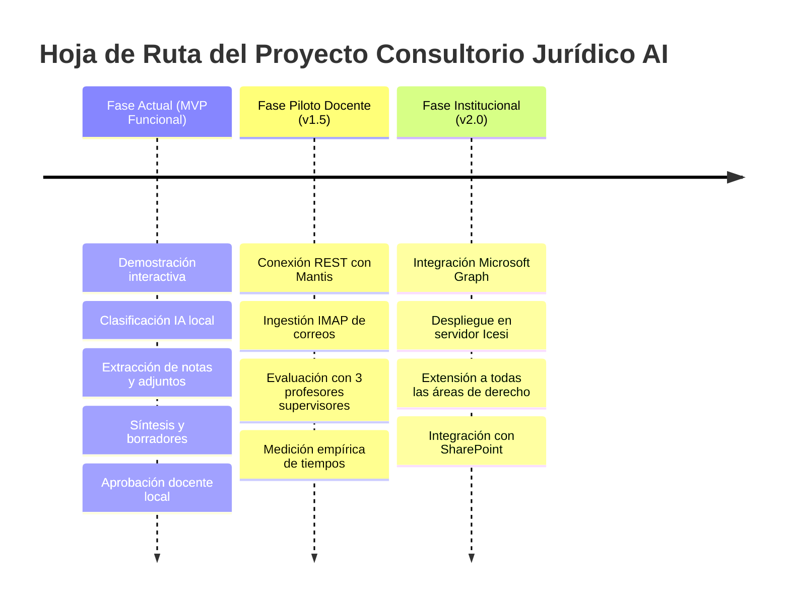

# Limitaciones Conocidas, Decisiones Pendientes y Roadmap de Integración
**Consultorio Jurídico - Universidad Icesi**

---

## 1. Alcance y Limitaciones Actuales del MVP

El presente sistema es un **Producto Mínimo Viable (MVP) de demostración académica y validación operativa**. Fue concebido para evidenciar ante profesores, directores y coordinadores cómo la inteligencia artificial puede reducir drásticamente el tiempo de revisión de notificaciones sin incurrir en costes por tokens comerciales ni poner en riesgo la privacidad institucional.

### Limitaciones Identificadas en el MVP:
1. **Modo de Integración con Mantis:**
   - La versión actual opera con el adaptador `MockMantisAdapter`. Los casos cargados (`0060228`, `0061567`, `0062564`, etc.) fueron reconstruidos fielmente de las capturas reales, pero residen en un archivo JSON local.
   - Los datos están debidamente rotulados como **simulados** en la interfaz para prevenir confusiones.
2. **Recepción de Correo Institucional:**
   - No se conecta en tiempo real a la bandeja IMAP/Graph de la profesora Marcela Andrea Ríos Salazar, protegiendo credenciales personales.
   - La ingesta se realiza mediante archivos `.eml`, carga manual o presets demostrativos.
3. **No-Envío y No-Mutación Intencionales:**
   - Por diseño estricto de seguridad, el sistema no emite correos ni cambia estados en Mantis. Toda respuesta permanece en borrador editable.
4. **OCR para Documentos Escaneados:**
   - El analizador documental extrae texto nativo de DOCX, PDF y TXT. Para documentos escaneados como imagen fotocopiada, se deja prevista la integración con Tesseract OCR local en fases posteriores.

---

## 2. Requisitos Técnicos e Institucionales para Conectar Servicios Reales

Para transitar del MVP hacia una fase de piloto en producción institucional, se requiere coordinar con la Dirección de Tecnología y Servicios de Información (SYRI) de la Universidad Icesi los siguientes accesos:

### 2.1. Conexión con Mantis Bug Tracker
* **Mecanismo:** API REST de Mantis (`/api/rest/issues/{id}`).
* **Datos requeridos:**
  - Token de API institucional con permisos de solo lectura (`API Token` generado desde la cuenta de servicio de Mantis).
  - Configurar en `.env`:
    ```ini
    MANTIS_ADAPTER_TYPE="http"
    MANTIS_BASE_URL="https://www.icesi.edu.co/consultorio-juridico-app"
    MANTIS_API_TOKEN="Bearer <TOKEN_OTORGADO_POR_SYRI>"
    ```

### 2.2. Conexión con el Servidor de Correo Institucional (Outlook / Office 365)
* **Alternativa A: Microsoft Graph API (Recomendada institucionalmente)**
  - Requiere registro de aplicación en Azure Active Directory (Entra ID) con permisos `Mail.Read`.
  - Client ID, Tenant ID y Client Secret corporativo.
* **Alternativa B: Protocolo IMAP con Contraseña de Aplicación**
  - Servidor: `outlook.office365.com`, puerto 993 con SSL/TLS.
  - Tarea periódica (*background worker*) que consulte correos entrantes de `soporte-syri@listas.icesi.edu.co`.

### 2.3. Acceso a Carpetas de Expedientes en SharePoint
* En las notas de Mantis se identificaron enlaces como `https://icesiedu.sharepoint.com/.../Expedientes%20Usuarios/60228`.
* Con permisos de lectura en Microsoft Graph (`Files.Read.All`), el sistema podrá descargar automáticamente los anexos del caso sin depender de que el estudiante los adjunte directamente en el cuerpo de la nota.

---

## 3. Consideraciones de Privacidad y Cumplimiento Normativo (Habeas Data)

* **Ley Estatutaria 1581 de 2012 (Colombia):** Los consultorios jurídicos tratan datos personales sensibles de usuarios (datos socioeconómicos, dirección, teléfono, litigios).
* **Cumplimiento Estricto en esta Arquitectura:**
  - **Sin APIs Comerciales en la Nube:** Ningún dato sensible de usuarios o estudiantes viaja a servidores de OpenAI, Claude, Google o Microsoft externos.
  - **Inferencia On-Premise:** Toda la IA se ejecuta en el servidor local de la universidad o mediante el motor de reglas deterministicas.
  - **Trazabilidad:** Cada acción y revisión humana queda asentada en la tabla `audit_logs` con sello de tiempo e identidad del profesor revisor.

---

## 4. Hoja de Ruta (Roadmap v2.0)


